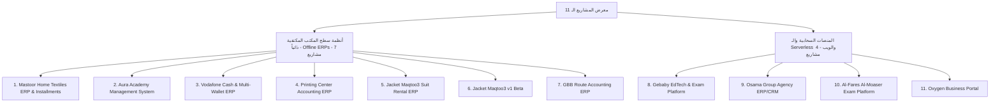
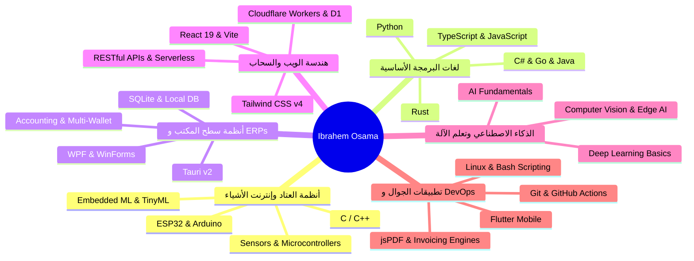

# 📋 التقرير الفني الشامل والمفصل لمشروع معرض الأعمال والأنظمة البرمجية
> **المهندس:** إبراهيم أسامة حسن (Ibrahem Osama Hassan)  
> **المجال:** مهندس برمجيات | أنظمة سطح مكتب (ERP) وويب وإنترنت الأشياء (IoT)  
> **الجامعة والتخصص:** جامعة أسيوط التكنولوجية الجديدة (NATU) - كلية تكنولوجيا الصناعة والطاقة - قسم تكنولوجيا المعلومات (دفعة 2026 - تقدير: جيد جداً)  
> **المستودع والنطاق:** `gebaby-rgb.github.io` (GitHub Pages)  
> **تاريخ التحديث:** أكتوبر 2026  

---

## فهرس المحتويات
1. [المقدمة والرؤية العامة](#1-المقدمة-والرؤية-العامة)
2. [الهيكل المعماري والملفات](#2-الهيكل-المعماري-والملفات)
3. [نظام التصميم والهوية البصرية الحديثة (Design System)](#3-نظام-التصميم-والهوية-البصرية-الحديثة-design-system)
4. [المحركات البرمجية والوظائف التفاعلية المحدثة](#4-المحركات-البرمجية-والوظائف-التفاعلية-المحدثة)
5. [التحليل الهندسي المفصل للمشاريع المعروضة (11 مشروعاً)](#5-التحليل-الهندسي-المفصل-للمشاريع-المعروضة)
6. [صفحة تفاصيل المشاريع الديناميكية (project.html)](#6-صفحة-تفاصيل-المشاريع-الديناميكية-projecthtml)
7. [قسم الفيديو الاستعراضي المباشر](#7-قسم-الفيديو-الاستعراضي-المباشر)
8. [خريطة المهارات والمصفوفة التقنية الموسعة (6 فئات)](#8-خريطة-المهارات-والمصفوفة-التقنية-الموسعة)
9. [تقييم الأداء ونقاط القوة والتوصيات](#9-تقييم-الأداء-ونقاط-القوة-والتوصيات)

---

## 1. المقدمة والرؤية العامة

يمثل هذا المشروع منصة رقمية هندسية متكاملة ومعرض أعمال مهني رفيع المستوى للمهندس **إبراهيم أسامة حسن**. تم بناء وتحديث الموقع بهدف تقديم برهان عملي وملموس على كفاءة المطور في هندسة وتطوير الأنظمة المعقدة وتطبيقات الشركات وحسابات المؤسسات.

### الركائز الأساسية التي يبرزها المشروع:
- **أنظمة سطح المكتب المكتفية ذاتياً (Offline-First Desktop ERPs):** بناء برمجيات متكاملة لا تعتمد على الاتصال بالإنترنت، تدير الحسابات والورديات والمخازن ونقاط البيع وأنظمة التقسيط عبر معمارية **Tauri v2 + Rust + React 19 + SQLite**.
- **الحلول السحابية الخفيفة الخالية من الخوادم التقليدية (Serverless Architectures):** استخدام تقنيات متقدمة مثل **Cloudflare Workers** و **D1 (SQLite at Edge)** و **Cloudflare Pages** و **Google Apps Script** لتحقيق أداء عالي بتكلفة تشغيل صفرية وزمن استجابة عالمي يقل عن 50 ملي ثانية.
- **تكامل العتاد والبرمجيات (Hardware & IoT Integration):** الخبرة الميدانية في برمجة وتصميم الدوائر المدمجة (**ESP32 / Arduino / C++**) والذكاء الاصطناعي المصغر (**Embedded ML / TinyML**).
- **منظومة الفلترة التفاعلية والشريط الإحصائي الفوري:** تمكين الزوار والعملاء من فرز المشاريع فورياً بين أنظمة سطح المكتب والـ ERP (7 مشاريع) ومنصات الويب والسحاب (4 مشاريع) بإجمالي **11 مشروعاً حقيقياً**.

---

## 2. الهيكل المعماري والملفات

تم تنظيم المشروع ليعمل باستقلالية تامة وبسرعة تحميل قياسية عبر البنية الهيكلية التالية:

```plaintext
d:\My_portfolio\
│
├── index.html                           # الصفحة الرئيسية التفاعلية الكاملة (تتضمن شريط الإحصائيات وفلاتر المشاريع)
├── project.html                         # محرك عرض تفاصيل المشاريع الديناميكي والغاليري وسلايدر الصور
│
├── css\
│   └── style.css                        # نظام التصميم الشامل، المتغيرات، الفلاتر، وتوافق RTL/LTR الكامل
│
├── js\
│   └── main.js                          # المحرك البرمجي، فلترة المشاريع، نظام الترجمة، ومراقبة التمرير
│
├── assets\
│   ├── cv\
│   │   └── Ibrahem_Osama_Hassan_CV.pdf  # السيرة الذاتية الرسمية للمهندس (PDF)
│   │
│   ├── video\
│   │   └── 202607251047 (1).mp4         # مقطع فيديو حي يستعرض الأنظمة البرمجية وتطبيقات سطح المكتب (~25.6MB)
│   │
│   └── images\                          # أكثر من 100 لقطة شاشة ورسم بياني لأنظمة المشاريع الفعلية
│       ├── project\                     # 10 لقطات شاشة كاملة لنظام مستور لإدارة الأقمشة والتقسيط
│       ├── project1\                    # 14 لقطة شاشة كاملة لمنصة جيبابي التعليمية للامتحانات
│       ├── aura academy 0.png..16.png   # 17 لقطة شاشة لنظام أكاديمية أورا التعليمي
│       ├── agency-ERP 0.jpeg..9.jpeg    # 10 لقطات شاشة لنظام إدارة الوكالات
│       └── ...                          # بقية لقطات شاشة الأنظمة المحاسبية
│
└── PROJECT_REPORT.md                    # هذا التقرير الفني الشامل والمفصل
```

---

## 3. نظام التصميم والهوية البصرية الحديثة (Design System)

تم بناء الموقع بأسلوب تقني حديث وفخم يجمع بين الفخامة والوضوح والسرعة وفق أحدث معايير الويب:

### أ. لوحة الألوان المعتمدة (Futuristic Dark Theme)
- **الخلفية العميقة (`--bg-dark`):** `#080B11` توفر خلفية داكنة فائقة الراحة للعين تمنح تبايناً مريحاً.
- **الخلفية الثانوية (`--bg-deep`):** `#0D131F` لتمييز الأقسام المختلفة وبطاقات الإحصائيات.
- **اللون الأساسي (`--accent`):** السايان المتوهج `#06B6D4` (Cyan/Teal) الذي يرمز للحداثة والابتكار التكنولوجي.
- **اللون المالي المساعد (`--accent-secondary`):** الأخضر الزمردي `#10B981` (Emerald) لتعزيز الجانب المحاسبي والمالي للأنظمة.
- **تأثيرات الزجاج الحديثة (Glassmorphism):** بطاقات شفافة بنسبة `rgba(17, 25, 40, 0.65)` مع تشويش خلفي `backdrop-filter: blur(12px)` وحدود مضيئة تتفاعل مع حركة المؤشر بوهج ناعم.

### ب. خطوط الطباعة ثنائية اللغة (Typography Matrix)

| اللغة | خط العناوين (Headings) | خط النصوص (Body Text) | خصائص الاتجاه |
|---|---|---|---|
| **الإنجليزية (LTR)** | `Outfit`, sans-serif | `Inter`, sans-serif | تباعد أحرف دقيق (`-0.02em`) |
| **العربية (RTL)** | `Cairo`, sans-serif | `Tajawal`, sans-serif | تباعد أحرف طبيعي متناسق (`0`) |

---

## 4. المحركات البرمجية والوظائف التفاعلية المحدثة

### 1. شريط إحصائيات الواجهة الرئيسية (Hero Stats Ribbon)
مصفوفة بصرية في مقدمة الموقع تضم 4 مؤشرات رقمية تشغيلية دقيقة:
1. **11+ مشاريع برمجية متكاملة:** أنظمة مطورة فعلياً لعملاء وتجار ومؤسسات.
2. **100% أنظمة مكتفية بدون إنترنت (Offline-Resilient):** استقرار تام لقواعد بيانات SQLite محلياً.
3. **خريج تكنولوجيا المعلومات 2026:** جامعة أسيوط التكنولوجية الجديدة بتقدير عام جيد جداً.
4. **10+ لغات برمجة وتقنيات:** إتقان هندسي يشمل Rust, TypeScript, Python, C#, Go, C++, SQLite, React 19, Cloudflare.

### 2. محرك فرز وتصنيف المشاريع التفاعلي (Projects Category Filter Engine)
شريط فلترة متطور أعلى شبكة المشاريع يتيح التبديل السلس بين:
- **جميع المشاريع (11):** استعراض شامل لكافة الأنظمة المعروضة.
- **تطبيقات سطح المكتب و ERP (7):** عرض البرمجيات المحلية المحاسبية (مستور، أكاديمية أورا، فودافون كاش، المطابع، جاكت مقطوع، جاكت v1، و GBB).
- **المنصات السحابية والويب (4):** عرض البوابات والمنصات السحابية (منصة جيبابي، وكالة أسامة، منصة الفارس، وموقع أوكسجين).
- يدعم الفرز تأثيرات حركية فورية بالـ CSS Transforms دون إعادة تحميل الصفحة.

### 3. محرك التبديل والترجمة ثنائي اللغة (Bilingual Engine)
- محرك ترجمة مدمج يتعامل مع القواميس البرمجية باللغتين العربية والإنجليزية لكافة العناصر والبطاقات.
- تبديل مباشر للنصوص والاتجاهات (`dir="rtl"` و `dir="ltr"`) مع تعديل ذكي للأيقونات والفواصل.
- حفظ اختيار المستخدم في الذاكرة المحلية للمتصفح (`localStorage.setItem('portfolio_lang', lang)`).

### 4. شريط التنقل الزجاجي الذكي (Dynamic Glass Navbar)
- استشعار مسافة التمرير (`window.scrollY > 50`) وتطبيق فئة `.scrolled` لإعطاء مظهر زجاجي شفاف ومثبت في الأعلى.
- تتبع القسم النشط على الشاشة لحظة بلحظة باستخدام **`IntersectionObserver`** وتحديد الرابط المقابل في القائمة.
- قائمة جانبية سلسة متوافقة مع شاشات الهواتف والأجهزة اللوحية.

### 5. التفاعل مع الحافظة (One-Click Clipboard Copy)
- نسخ عنوان البريد الإلكتروني الرسمي بنقرة واحدة وتحديث الزر إلى إشعار تأكيدي أخضر: `"تم نسخ البريد بنجاح!"` لمدة ثانيتين.

---

## 5. التحليل الهندسي المفصل للمشاريع المعروضة

يضم المعرض حالياً **11 مشروعاً حقيقياً وموثقاً بالكامل** باللقطات الحية:



---

### جدول مقارنة المشاريع الـ 11 الشامل:

| # | اسم المشروع | نوع البيئة | التقنيات الأساسية | لقطات الشاشة | أهم الإنجازات التشغيلية |
|---|---|---|---|---|---|
| **1** | **نظام مستور للأقمشة والتقسيط** | Desktop ERP | React 19, Tauri v2, Rust, SQLite | 10 صور | إدارة عقود التقسيط مع الضامنين وحساب كسور الأمتار وتعدد الخزائن |
| **2** | **منصة جيبابي المركزية للامتحانات** | Cloud Platform | Cloudflare Pages, Workers, D1, TS | 14 صورة | محرك امتحانات مع تصحيح آلي فوري، رتب تفاعلية (Gamification)، ومكتبة مذكرات |
| **3** | **نظام إدارة أكاديمية أورا** | Desktop ERP | React 19, Tauri v2, Rust, SQLite | 17 صورة | توحيد شؤون الطلاب، كافيه POS، تسوية الورديات، والرواتب في نظام أوفلاين |
| **4** | **برنامج فودافون كاش والمحافظ** | Desktop ERP | React, TypeScript, Tauri v2, SQLite | 10 صور | خوارزمية "أرخص مسار تحويل" ورفع أرباح الوكيل بنسبة 12-18% |
| **5** | **برنامج حسابات وفواتير المطابع** | Desktop ERP | Tauri v2, Tailwind v4, Recharts, jsPDF | 9 صور | حاسبة تسعير ورق متقدمة وتصدير تقارير وفواتير PDF في أقل من 10 ثوانٍ |
| **6** | **برنامج جاكت مقطوع للبدلات** | Desktop ERP | Tauri, React, SQLite, Tailwind | 9 صور | تقويم حجوزات ذكي يمنع تضارب المواعيد وسجل مقاسات تفصيلية للعملاء |
| **7** | **برنامج جاكت مقطوع v1** | Desktop ERP | React, Vite, Tauri, SQLite | 8 صور | نسخة أولية تجريبية محققة سرعة استعلام محلي أقل من 10 ملي ثانية |
| **8** | **نظام حسابات خطوط النقل GBB** | Desktop ERP | React, Tauri, Vite, Local DB | 10 صور | تقليص تسوية السائقين والرحلات اليومية من ساعتين إلى أقل من 5 دقائق |
| **9** | **منصة الفارس المعاصر للامتحانات** | Serverless Web | Google Apps Script, Sheets, Pages | 3 صور | منصة امتحانات بدون خوادم مع كشف محاولات الغش وتصحيح فوري مجاني |
| **10** | **نظام إدارة الوكالات Osama Group** | Cloud ERP/CRM | Cloudflare Workers, D1, Backblaze B2 | 10 صور | 11 دوراً وظيفياً وسير عمل للمشاريع بـ 7 مراحل واجتياز 396 اختبار أمان |
| **11** | **موقع أوكسجين للاستشارات** | Web Portal | HTML5, Bootstrap 5, Vanilla JS, AOS | 4 صور | تقييم 98+ على Google Lighthouse وزمن تحميل 0.4 ثانية على شبكات الجيل الرابع |

---

### تفاصيل المشاريع الرئيسية المضافة حديثاً:

#### 1. نظام مستور لإدارة الأقمشة والمفروشات والتقسيط (Mastoor Home Textiles ERP)
- **المجلد والمصدر:** `assets/images/project/` (10 لقطات شاشة: `Screenshot (244).png` إلى `Screenshot (253).png`).
- **الحزمة التقنية:** React 19, Tauri v2, Rust, SQLite, TypeScript, Tailwind CSS, Zustand.
- **طبيعة النظام:** نظام سطح مكتب محاسبي وإداري متكامل (Offline-First) لمتاجر وتجار الأقمشة والمفروشات المنزلية.
- **التحدي الهندسي والمشكلة:** معاناة تجار الأقمشة من صعوبة حساب كسور الأمتار وتوالف التقطيع، وتشتت حسابات أقساط الزبائن وسندات الضامنين في دفاتر ورقية معرضة للتلف والنسيان، مع اختلاط أموال المحافظ الإلكترونية بالسيولة النقدية.
- **الحلول الهندسية المنجزة:**
  - برمجة محرك مخازن مزدوج يدعم القياس بالوحدة المزدوجة (طاقات كاملة / أمتار مباعة / توالف التقطيع).
  - منظومة عقود التقسيط المتكاملة: تسجيل الأقساط، بيانات الضامنين، جداول السداد، والتنبيهات الملونة للديون المتأخرة.
  - إدارة خزائن مالية متعددة: رصيد نقدية الدرج، رصيد فودافون كاش، ورصيد إنستاباي ومطابقتها لحظياً.
  - شاشة كاشير POS فائقة السرعة تدعم قارئ الباركود، الفواتير المعلقة، الخصومات، والطباعة الحرارية.

#### 2. منصة جيبابي المركزية لإدارة التعليم والامتحانات (Gebaby EdTech Platform)
- **المجلد والمصدر:** `assets/images/project1/` (14 لقطة شاشة: `Screenshot (227).png` إلى `Screenshot (240).png`).
- **الحزمة التقنية:** Cloudflare Pages, Cloudflare Workers, TypeScript, D1 (SQLite at Edge), Tailwind CSS, Chart.js, REST API.
- **طبيعة النظام:** منصة تعليمية سحابية متكاملة للمعلمين والطلاب مستضافة على حافة شبكة Cloudflare العالمية.
- **التحدي الهندسي والمشكلة:** تشتت المعلمين والطلاب بين جروبات واتساب وجداول إكسل لمتابعة الحصص والمذكرات، وصعوبة إجراء امتحانات محددة الوقت مع تصحيح آلي فوري، وغياب بيئة مركزية تحفز الطلاب على التنافس وتمنح الإدارة رقابة كاملة على سجلات النشاط.
- **الحلول الهندسية المنجزة:**
  - لوحة تحكم إدارية مركزية: إحصائيات الطلاب والمعلمين، المحاولات المسلمة، متوسط الدرجات، والشكاوى.
  - سجل تدقيق كامل وشامل (Audit Log) يوثق كل إجراء من المعلمين والمديرين مع فلاتر التاريخ والمستخدم.
  - بوابة المعلم: إدارة مجموعات الطلاب، بنك الأسئلة، وإعداد ونشر الامتحانات المجدولة المؤقتة.
  - مكتبة رقمية متطورة تدعم رفع وتصنيف مذكرات الـ PDF والربط مع فيديوهات YouTube و Google Drive.
  - بوابة الطالب الذكية: تصفح المعلمين، إرسال طلبات الانضمام، وأداء الامتحانات المؤقتة فورياً.
  - نظام تحفيز وترتيب تفاعلي (Gamification & Ranking) يمنح نقاط وأوسمة برونزية وذهبية للطلاب المتفوقين.

---

## 6. صفحة تفاصيل المشاريع الديناميكية (`project.html`)

تتميز معمارية الموقع بفصل صفحات التفاصيل في نظام عرض ديناميكي ذكي:
- **التوجيه بالمعرّف (URL Parameter Routing):** تستقبل الصفحة معرّف المشروع مثل: `project.html?id=mastoor` أو `project.html?id=gebaby-platform`.
- **معرض الصور والسلايدر:** عرض الصورة الأساسية بدقة عالية، مع شريط صور مصغرة (Thumbnails) تفاعلي يتسع لجميع لقطات الشاشة (حتى 14 صورة للمشروع) مع تظليل العنصر النشط.
- **المعلومات الهندسية المنهجية:**
  - **العميل (Client):** المؤسسة أو الشركة التي بُني النظام لأجلها.
  - **المشكلة البرمجية (The Problem):** العوائق السابقة التي كان يواجهها العميل.
  - **القرارات والتحديات الهندسية (Challenges):** المعايير والقرارات البرمجية المتبعة لحل المشكلة.
  - **النتائج القابلة للقياس (Measurable Results):** نسب التحسن الملموسة في أوقات العمل والأرباح.
  - **الحالة الحالية (Status):** توثيق جاهزية النظام واعتماده في بيئة العمل الحقيقية.

---

## 7. قسم الفيديو الاستعراضي المباشر

يحتوي الموقع على قسم فيديو مخصص (`#video-demo`):
- **ملف الفيديو المصدر:** `assets/video/202607251047 (1).mp4` (بحجم ~25.6MB).
- **غلاف المشغل (Poster):** `assets/images/vodafone_cash_preview.png`.
- **الهدف:** استعراض مقطع تسجيلي حي ومباشر للأنظمة أثناء تشغيلها على نظام ويندوز، بما يثبت سرعة استجابة قواعد البيانات المحلية وتفاعل الواجهات.

---

## 8. خريطة المهارات والمصفوفة التقنية الموسعة

تم توسيع وتنظيم مهارات المهندس التقنية في **6 فئات رئيسية حديثة** مجهزة بمؤشرات تقدم رقمية وأيقونات متخصصة:



| الفئة التقنية | التقنيات واللغات المعتمدة | مستوى الإتقان |
|---|---|---|
| **1. أنظمة العتاد وإنترنت الأشياء (Embedded & IoT)** | ESP32, Arduino, C / C++, Embedded ML, Sensors | متقدم (80% - 92%) |
| **2. لغات البرمجة الأساسية (Core Languages)** | Rust, TypeScript, JavaScript, Python, C#, Go, Java, Dart | متقدم إلى متوسط (75% - 95%) |
| **3. أنظمة سطح المكتب والـ ERP (Desktop & ERPs)** | Tauri v2, SQLite, React 19, WPF, WinForms, POS Engines | متقدم (88% - 94%) |
| **4. هندسة الويب والسحاب (Web & Cloud Architecture)** | Cloudflare Workers, Pages, D1 (SQLite), REST APIs, Tailwind CSS v4 | متقدم (90% - 95%) |
| **5. الذكاء الاصطناعي وتعلم الآلة (AI & Machine Learning)** | AI Fundamentals, Deep Learning Basics, Computer Vision, Edge AI | متقدم إلى متوسط (75% - 86%) |
| **6. تطبيقات الجوال وأدوات الـ DevOps** | Flutter, Git, GitHub Actions, Linux / Bash, jsPDF | متقدم (84% - 92%) |

---

## 9. تقييم الأداء ونقاط القوة والتوصيات

### نقاط القوة الهندسية:
1. **قيمة تجارية وتشغيلية مثبتة:** 11 مشروعاً حقيقياً نفذت لتجار ومؤسسات ومراكز تعليمية وحلت أزمات تشغيلية معقدة.
2. **معمارية خفيفة بدون أعباء مالية (Zero Server Cost):** اعتماد تقنيات Serverless على Cloudflare و Google Apps Script، وتقنيات Offline-First على أجهزة العملاء.
3. **تجربة مستخدم فائقة السرعة والسلاسة:** الموقع لا يعتمد على أطر عمل ضخمة تبطئ التحميل، وتعمل الفلاتر ومحركات الترجمة فورياً.
4. **تكامل كامل بين الواجهات والتوثيق:** ربط سلس بين بطاقات المعرض الرئيسية وصفحات التفاصيل الموسعة بصور حية خالية من أخطاء الروابط.

### الخطوات القادمة المقترحة:
1. **إيداع التعديلات ورفعها (Git Commit & Push):** رفع كافة التحديثات إلى المستودع الرئيسي `gebaby-rgb.github.io` لتحديث النسخة المنشورة على GitHub Pages فوراً.
2. **ضغط لقطات الشاشة الجديدة:** تحويل ملفات PNG الكبيرة إلى صيغة `WebP` المضغوطة لتوفير البيانات وتسريع التصفح على شبكات المحمول.
3. **توليد خريطة الموقع (sitemap.xml):** لتعزيز فهرسة المشاريع الـ 11 ومحركات البحث لمحفظة الأعمال الهندسية.

---
> ✍️ **تم إعداد وتحديث هذا التقرير لتوثيق وتفصيل كافة المكونات الهندسية والتطبيقية لمشروع Portfolio المهندس إبراهيم أسامة حسن (11 مشروعاً - دفعة 2026).**
